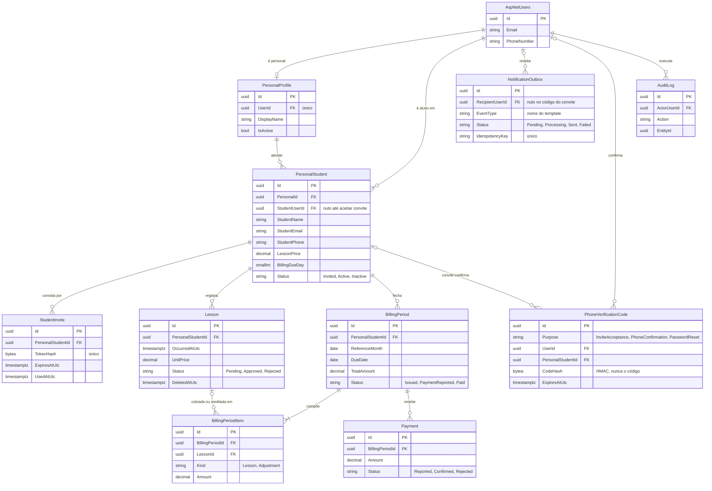
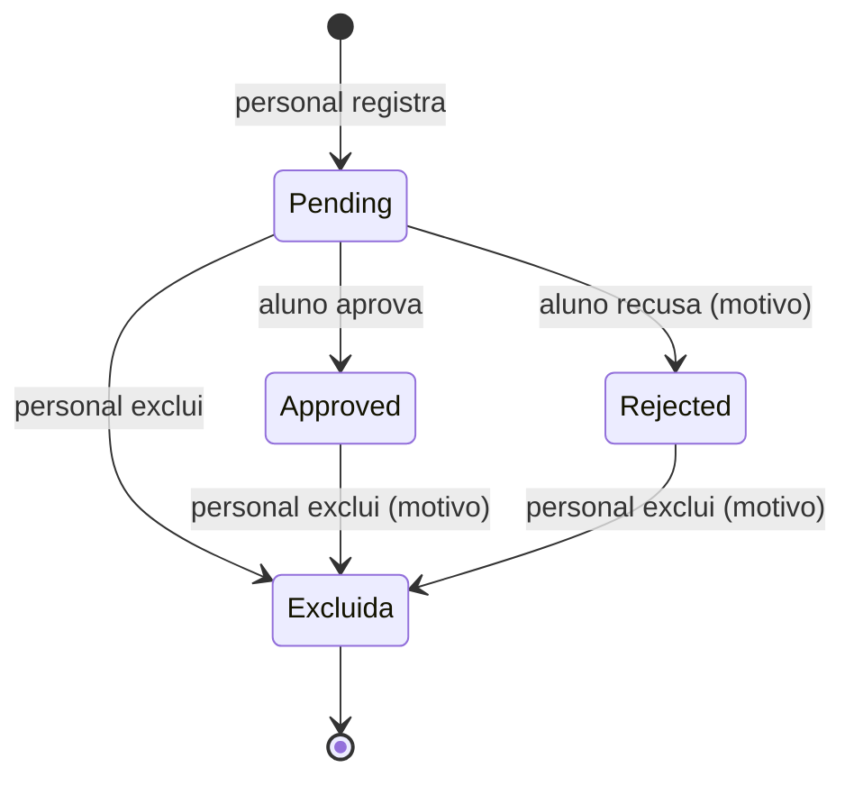
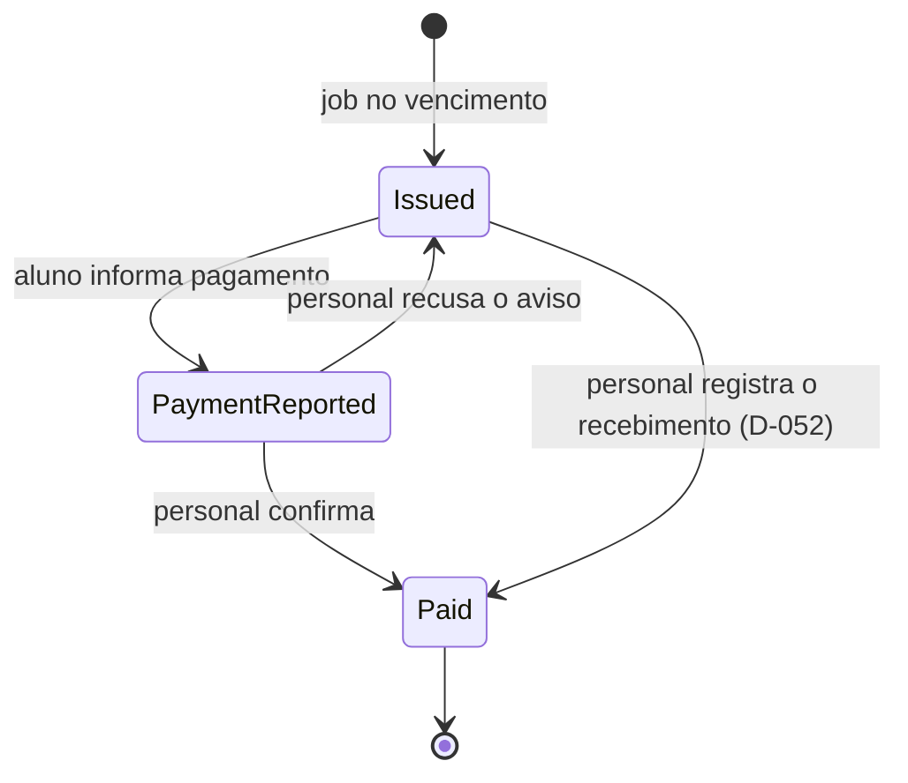

# PersonalHub — Domínio e modelo do banco

## 1. Objetivo

Este documento descreve o modelo de dados aprovado em 2026-11-03 (D-029), com base nas decisões D-015 a D-028 de `DECISIONS.md`. Qualquer mudança no modelo deve ser registrada como nova decisão.

Banco: PostgreSQL. ORM: Entity Framework Core com provider Npgsql compatível com .NET 10.

## 2. Princípios de modelagem
- Chaves primárias UUID (`uuid`) em todas as entidades de negócio.
- Instantes em UTC (`timestamptz`); datas de período e vencimento em `date` no fuso `America/Sao_Paulo` (D-026).
- Valores monetários com `numeric(12,2)` em BRL; nunca usar `float`/`double` para dinheiro.
- Concorrência otimista pela coluna de sistema `xmin` do PostgreSQL (sem coluna extra).
- Exclusão lógica e auditoria para registros com relevância histórica.
- Toda tabela de domínio tem `CreatedAtUtc` (omitida nas tabelas abaixo).
- Índices para consultas por proprietário, aluno, período e estado.
- Restrições de integridade no banco sempre que possível.
- Não armazenar CPF (D-017) nem dados de cartão ou credenciais de pagamento no MVP.

## 3. Visão geral

Tudo pende do vínculo `PersonalStudent`: aulas, demonstrativos e pagamentos pertencem a um par personal–aluno, o que torna a checagem de autorização uma única junção.

Três escolhas moldam o resto:
- **O vínculo guarda os dados que o personal digitou** (nome, e-mail, celular). A conta do aluno é só a identidade de login. Assim um aluno pode ter vários personais (D-015) sem que um veja o que o outro cadastrou.
- **Cada aula guarda o próprio preço** (`UnitPrice`) no momento do registro (D-018).
- **Demonstrativo emitido nunca muda.** Exclusão posterior vira crédito no mês seguinte (D-023).



## 4. Tabelas

### 4.1 Identity
ASP.NET Core Identity com chaves `Guid` e duas roles: `Personal` e `Student`. Nenhuma tabela de senha própria. `AspNetUsers.FullName varchar(150) null` guarda o nome que o aluno informou no aceite do convite (D-032). Não permitir autoelevação para a role `Personal`.

Fase 6: `AspNetUsers.PhoneNumber` (E.164) e `PhoneNumberConfirmed` passam a ser usados. São preenchidos quando o aluno confirma o código no aceite do convite (D-057) ou na confirmação de celular dos alunos antigos (D-059), sempre com o `StudentPhone` do vínculo. É o celular dos avisos ao aluno e da recuperação de senha (D-058). O personal recebe no `PersonalProfile.PhoneNumber`.

### 4.2 PersonalProfile

| Coluna | Tipo | Regras |
| --- | --- | --- |
| UserId | uuid | FK Identity, único |
| DisplayName | varchar(120) | obrigatório |
| PhoneNumber | varchar(20) | formato E.164, para WhatsApp |
| IsActive | boolean | personal inativo não entra |

Criado somente pelo script de provisionamento (D-027).

### 4.3 PersonalStudent (vínculo)

| Coluna | Tipo | Regras |
| --- | --- | --- |
| PersonalId | uuid | FK `PersonalProfile` |
| StudentUserId | uuid null | FK Identity; preenchido ao aceitar o convite |
| StudentName | varchar(150) | obrigatório |
| StudentEmail | varchar(256) | obrigatório, guardado normalizado |
| StudentPhone | varchar(20) | obrigatório, E.164 |
| LessonPrice | numeric(12,2) | `> 0` |
| BillingDueDay | smallint | `BETWEEN 1 AND 31` |
| Status | varchar(16) | `Invited`, `Active`, `Inactive` |
| ActivatedAtUtc, EndedAtUtc | timestamptz null | `EndedAtUtc` obrigatório quando `Inactive` (D-028) |

Índices: único `(PersonalId, StudentUserId)` onde `StudentUserId IS NOT NULL`; único `(PersonalId, StudentEmail)` onde `Status <> 'Inactive'`; `(StudentUserId, Status)`; `(PersonalId, Status)`.

### 4.4 StudentInvite

| Coluna | Tipo | Regras |
| --- | --- | --- |
| PersonalStudentId | uuid | FK vínculo |
| TokenHash | bytea | SHA-256 do token, único; o token puro nunca é gravado |
| ExpiresAtUtc | timestamptz | 7 dias após criar (D-016) |
| UsedAtUtc, RevokedAtUtc | timestamptz null | usado ou revogado = inválido |

### 4.5 Lesson

| Coluna | Tipo | Regras |
| --- | --- | --- |
| PersonalStudentId | uuid | FK vínculo |
| CreatedByUserId | uuid | FK Identity (o personal) |
| OccurredAtUtc | timestamptz | quando a aula aconteceu; pode ser retroativa |
| DurationMinutes | smallint null | opcional, `> 0` |
| Notes | varchar(500) null | opcional |
| UnitPrice | numeric(12,2) | cópia de `LessonPrice` no registro |
| Status | varchar(16) | `Pending`, `Approved`, `Rejected` |
| RespondedAtUtc, RespondedByUserId | null | preenchidos juntos quando o aluno decide |
| RejectionReason | varchar(500) null | obrigatório quando `Rejected` (D-021) |
| DeletedAtUtc, DeletedByUserId | null | exclusão lógica |
| DeletionReason | varchar(500) null | obrigatório se excluída com `Status <> 'Pending'` |

Índices: `(PersonalStudentId, OccurredAtUtc)` e `(PersonalStudentId, Status)`, ambos filtrando `DeletedAtUtc IS NULL`.

### 4.6 BillingPeriod

| Coluna | Tipo | Regras |
| --- | --- | --- |
| PersonalStudentId | uuid | FK vínculo |
| ReferenceMonth | date | sempre dia 1; único com o vínculo |
| PeriodStart, PeriodEnd | date | início inclusivo, fim exclusivo |
| DueDate | date | dia de vencimento ajustado ao mês (D-025) |
| TotalAmount | numeric(12,2) | soma dos itens, `>= 0` |
| Status | varchar(20) | `Issued`, `PaymentReported`, `Paid` |
| IssuedAtUtc, PaidAtUtc | timestamptz | `PaidAtUtc` só com `Paid` |

O índice único `(PersonalStudentId, ReferenceMonth)` torna o job de fechamento idempotente: rodar duas vezes não cria dois demonstrativos.

Fechamento (D-043 a D-047): no vencimento, a partir de 00:00 de São Paulo, entram as aulas `Approved` não excluídas, de antes do fim do mês de referência, confirmadas antes desse corte e ainda não cobradas. Sem aula nem crédito novo, nada é emitido. Total zero nasce `Paid` com `PaidAtUtc`. A regra está em `Domain/Billing/BillingClosing` (funções puras); o job só busca e grava.

### 4.7 BillingPeriodItem

| Coluna | Tipo | Regras |
| --- | --- | --- |
| BillingPeriodId | uuid | FK período |
| Kind | varchar(16) | `Lesson` ou `Adjustment` |
| LessonId | uuid null | FK aula |
| Description | varchar(200) | texto congelado para o demonstrativo |
| Amount | numeric(12,2) | positivo em `Lesson`, negativo em crédito |

Índice único `(LessonId, Kind)`: uma aula é cobrada no máximo uma vez e creditada no máximo uma vez. Se os créditos passarem do total, o saldo vai para o mês seguinte (D-023): o próximo demonstrativo recebe um `Adjustment` sem `LessonId` ("Saldo de crédito de {mês}"). O saldo de um demonstrativo é a parte negativa da soma dos seus itens, então não precisa de coluna própria.

### 4.8 Payment

| Coluna | Tipo | Regras |
| --- | --- | --- |
| BillingPeriodId | uuid | FK período |
| Amount | numeric(12,2) | igual ao total do período (D-024) |
| Status | varchar(16) | `Reported`, `Confirmed`, `Rejected` |
| ReportedByUserId, ReportedAtUtc | | o aluno que informou (o personal, no registro direto) |
| DecidedByUserId, DecidedAtUtc | null | o personal que confirmou ou recusou |
| Notes | varchar(500) null | observação opcional do aluno, sem comprovante no MVP |
| DecisionNote | varchar(500) null | mensagem opcional do personal ao recusar, visível ao aluno; só com `Rejected` (D-051) |

Índice único `(BillingPeriodId)` onde `Status IN ('Reported','Confirmed')`: só um pagamento ativo por período. Índice `(BillingPeriodId, ReportedAtUtc)` para o histórico (D-053).

Registro direto pelo personal (D-052): `Confirmed` com `ReportedByUserId = DecidedByUserId` (o personal) e mesmo instante; não há coluna de origem, porque o aluno nunca decide. As transições estão em `Domain/Billing/Payment` e `BillingPeriod`; o handler trava o período com `FOR UPDATE`.

### 4.9 NotificationOutbox
Fila persistente de notificações a enviar (Fase 6, D-060 a D-062).

| Coluna | Tipo | Regras |
| --- | --- | --- |
| EventType | varchar(100) | nome do template (`ph_nova_aula`, `ph_codigo`…) |
| RecipientUserId | uuid null | FK Identity; nulo no código do convite (o aluno ainda não tem conta) |
| RecipientPhone | varchar(20) null | E.164 no momento do enfileiramento; nulo = sem celular confirmado (encerra como `sem-celular`) |
| Payload | jsonb | `parameters` do corpo, `button` (sufixo da URL) e, nos códigos, `code` protegido pelo Data Protection; vira `{}` quando o código sai ou falha |
| Channel | varchar(16) | `WhatsApp` |
| Status | varchar(16) | `Pending`, `Processing`, `Sent`, `Failed` |
| IsAuthentication | boolean | código: ignora o silêncio e expira com o código |
| Attempts | int | `>= 0`; contada ao pegar a linha; máximo 5 |
| NextAttemptAtUtc | timestamptz | quando pode sair (silêncio 22h–8h e backoff) |
| LeaseExpiresAtUtc | timestamptz null | obrigatório com `Processing`; vencido, outra rodada retoma |
| ExpiresAtUtc | timestamptz null | depois disso não envia (código vencido) |
| SentAtUtc | timestamptz null | obrigatório com `Sent` |
| ProviderMessageId | varchar(128) null | id da Meta (`messages[0].id`), único quando preenchido |
| DeliveryStatus | varchar(16) null | `Sent`, `Delivered`, `Read`, `Failed`, pelo webhook; só avança |
| DeliveredAtUtc, ReadAtUtc | timestamptz null | pelo webhook |
| LastError | varchar(1000) null | só códigos sanitizados (`meta:131026`, `http:503`, `sem-celular`, `expirado`) |
| IdempotencyKey | varchar(100) | única: `lesson-created:<id>`, `lesson-approved:<id>`, `lesson-rejected:<id>`, `lesson-deleted:<id>`, `statement-issued:<id>`, `payment-reported:<id>`, `payment-confirmed:<id>`, `payment-rejected:<id>`, `phone-code:<id>` |

Índices: único `IdempotencyKey`; `(Status, NextAttemptAtUtc)`; único `ProviderMessageId` onde não nulo. A operação de negócio e o aviso são salvos na mesma transação; o worker envia depois e aplica retry controlado. Nunca depender do envio síncrono de WhatsApp para concluir registro de aula ou pagamento.

### 4.10 AuditLog
Trilha de auditoria para ações críticas:
- Id
- ActorUserId
- Action
- EntityType
- EntityId
- OccurredAtUtc
- CorrelationId
- Metadata minimizada e sanitizada

Índice `(EntityType, EntityId)`. Não copiar senha, tokens ou conteúdo pessoal desnecessário para auditoria.

### 4.11 PhoneVerificationCode
Códigos de 6 dígitos enviados por WhatsApp (D-056).

| Coluna | Tipo | Regras |
| --- | --- | --- |
| Purpose | varchar(24) | `InviteAcceptance`, `PhoneConfirmation`, `PasswordReset` |
| UserId | uuid null | FK Identity; obrigatório fora do convite |
| PersonalStudentId | uuid null | FK vínculo; obrigatório no convite (`CK_PhoneVerificationCode_Scope`) |
| PhoneE164 | varchar(20) | celular de destino, E.164 |
| CodeHash | bytea | HMAC-SHA256 (32 bytes) do código, com finalidade e dono; chave `PhoneVerification:HashKey` |
| ExpiresAtUtc | timestamptz | 10 minutos depois do envio |
| Attempts | int | `0..5` |
| ConsumedAtUtc | timestamptz null | código usado |
| ReplacedAtUtc | timestamptz null | substituído por um código mais novo |
| LockedUntilUtc | timestamptz null | bloqueio de 15 minutos (5 tentativas ou 4º pedido na hora) |

Índices: `(PhoneE164, Purpose, CreatedAtUtc)` para os limites por celular; `(PersonalStudentId, CreatedAtUtc)` e `(UserId, Purpose, CreatedAtUtc)` para o código aberto de cada dono. Concorrência por `xmin`; conferência com `FOR UPDATE`.

Migration: `AddWhatsApp` (Fase 6) cria esta tabela e completa a `NotificationOutbox`.

## 5. Estados e transições

A exclusão de aula não é um estado: fica em `DeletedAtUtc`, separada da decisão do aluno. Assim o histórico mostra, por exemplo, "aprovada e depois excluída pelo personal".

### 5.1 Aula



A resposta do aluno só vale se a aula estiver `Pending` e não excluída; respostas simultâneas são barradas pelo `xmin`.

### 5.2 Demonstrativo e pagamento



Cada aviso do aluno cria um `Payment` em `Reported`. A confirmação muda o pagamento para `Confirmed` e o período para `Paid` na mesma transação; a recusa muda o pagamento para `Rejected` (com a mensagem opcional) e devolve o período para `Issued`, e o aluno pode informar de novo. O registro direto cria o pagamento já `Confirmed`. `Paid` é definitivo (D-053). Demonstrativo com total zero já nasce `Paid` e não aceita aviso.

## 6. Identity e vínculo

O personal nasce por um script de linha de comando que cria o usuário, a role `Personal` e o `PersonalProfile` numa transação (D-027).

O aluno é cadastrado pelo personal como vínculo `Invited` e recebe um convite (D-016). Ao aceitar, ganha a role `Student` e o `StudentUserId` do vínculo é preenchido. Se o e-mail do convite já tiver conta (aluno de outro personal), o aceite pede login em vez de nova senha e só liga o vínculo.

Na gestão de alunos (Fase 2), o personal pode gerar um novo convite (revoga os anteriores na hora) ou cancelar o convite em aberto (D-034); trocar o e-mail só enquanto `Invited` (D-035). Inativar preenche `EndedAtUtc` e revoga o convite em aberto; reativar volta para `Active` se há `StudentUserId`, senão para `Invited` com um novo convite (D-037). Essas ações carregam o vínculo com `SELECT ... FOR UPDATE` numa transação, para não se cruzarem entre si nem com o aceite do convite.

## 7. Consultas principais

Toda consulta parte do vínculo filtrado pelo usuário logado. No código viram LINQ projetado para DTO.

```sql
-- Aulas do aluno logado em um mês (horário de São Paulo)
SELECT l."Id", l."OccurredAtUtc", l."Status", l."UnitPrice"
FROM "Lesson" l
JOIN "PersonalStudent" ps ON ps."Id" = l."PersonalStudentId"
WHERE ps."StudentUserId" = @userId
  AND l."DeletedAtUtc" IS NULL
  AND l."OccurredAtUtc" >= @inicioMesUtc AND l."OccurredAtUtc" < @fimMesUtc
ORDER BY l."OccurredAtUtc" DESC;

-- Aulas aprovadas ainda não cobradas, para o fechamento
SELECT l."Id", l."UnitPrice"
FROM "Lesson" l
WHERE l."PersonalStudentId" = @vinculoId
  AND l."Status" = 'Approved' AND l."DeletedAtUtc" IS NULL
  AND l."OccurredAtUtc" < @fimPeriodoUtc
  AND NOT EXISTS (SELECT 1 FROM "BillingPeriodItem" i
                  WHERE i."LessonId" = l."Id" AND i."Kind" = 'Lesson');

-- Pagamentos aguardando confirmação do personal logado
SELECT bp."ReferenceMonth", ps."StudentName", p."Amount", p."ReportedAtUtc"
FROM "Payment" p
JOIN "BillingPeriod" bp ON bp."Id" = p."BillingPeriodId"
JOIN "PersonalStudent" ps ON ps."Id" = bp."PersonalStudentId"
JOIN "PersonalProfile" pp ON pp."Id" = ps."PersonalId"
WHERE pp."UserId" = @userId AND p."Status" = 'Reported';
```

## 8. Regras de consistência
- Somente o personal proprietário do vínculo pode registrar ou excluir aulas.
- Somente o aluno associado pode aprovar/recusar uma aula.
- A resposta só pode ser aplicada se a aula estiver pendente.
- O personal não pode confirmar pagamento de período pertencente a outro personal.
- O aluno só pode reportar pagamento do próprio período.
- Aula não é cobrada em dois períodos (índice único em `BillingPeriodItem`).
- Exclusão de aula após fechamento gera crédito no próximo período; nunca alterar total histórico.
- Notificação pode falhar sem desfazer a operação de domínio; a outbox permite retentativa.
- Todas as operações críticas devem ser seguras contra repetição.

## 9. Pontos ainda abertos
- Prazo de retenção de dados após o fim do vínculo (P-017).
- Notificações dentro da aplicação (P-018), na Fase 7. Provedor e fluxo de WhatsApp resolvidos em D-055 e D-062.
- Retenção das linhas da outbox e dos códigos (limpeza periódica ainda não implementada).
- Nenhuma migration deve ser criada antes da configuração da solução (Fase 0, próximo passo).
